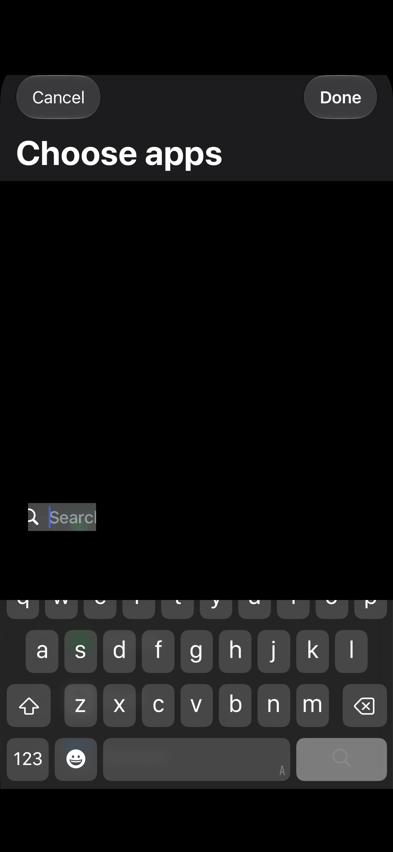

# Native element tap regression

`FamilyPickerFixture.swift` is a separate app fixture for the physical-iOS
snapshot-coordinate issue. It does not belong in the ArgentRunner app target.

## Set up the fixture

1. Create an iOS app and UI-test target in Xcode, using your own bundle ID and team.
2. Replace the app entry point with `FamilyPickerFixture.swift`.
3. Add only the standard Family Controls capability to the app target.
4. Sign and install the fixture on your test iPhone.
5. Open a picker and manually approve the ordinary Screen Time prompt.

For the automated device regression, add these files to the fixture UI-test target:

- `NativeElementTapRegressionTests.swift`
- `../ArgentRunner/ArgentRunnerUITests/RunnerProtocol.swift`
- `../ArgentRunner/ArgentRunnerUITests/NativeElementTap.swift`

Run `NativeElementTapRegressionTests` against that app. The tests compile the
production helper directly. They do not start the Argent HTTP server or replace
an installed Argent runner. The tests cover both picker layouts, normal fixture
buttons, rejected selectors, and the command's mutation policy. Invalid selectors
must not open either picker. The two duplicate fixture buttons deliberately share
an identifier so the ambiguity check has a deterministic test case.

Do not add the app-and-website-usage entitlement. This fixture does not need
exclusive usage-data access. It performs no usage reads, blocking, networking,
telemetry, or selection persistence. Cancel and Done clear the in-memory selection.

## Reproduce the snapshot problem

Open each presentation without selecting apps. Compare `app.snapshot()` Search
frames with `app.searchFields.firstMatch.frame` in XCTest. Then compare a
snapshot-center coordinate tap with `tap-element`:

```sh
argent run launch-app --args '{"udid":"<device-id>","bundleId":"<fixture-bundle-id>"}'
argent run tap-element --args '{"udid":"<device-id>","selector":{"label":"Search","role":"AXTextField"}}'
```

The fixture must already show a picker before the second command. A native
Search tap must reveal the keyboard. A normal fixture-button tap by identifier
and a Cancel-button tap must also work. Missing, ambiguous, and non-interactable
selectors must fail without touching a different control.

The initial reproduction on an iPhone 15 Pro running iOS 27.0.1 produced these
UIKit-point frames. The app frame and snapshot root both measured `(0,0,393,852)`.

| Presentation | Snapshot Search frame | Live Search frame | Snapshot-center tap | Native element tap |
| ------------ | --------------------- | ----------------- | ------------------- | ------------------ |
| Form sheet   | `(28,571,337,28)`     | `(28,752,337,28)` | No keyboard         | Keyboard appears   |
| Full screen  | `(28,587,337,28)`     | `(28,752,337,28)` | No keyboard         | Keyboard appears   |

These values are observations, not offsets to apply to other views. Full-screen
outer presentation does not remove this remote-picker coordinate discontinuity.
The native action avoids using the bulk snapshot coordinates. It does not repair
the coordinates returned by `describe`.

The checked-in fixture regression also exercises the production helper in both
layouts. `evidence/outcomes.json` records its geometry and Boolean results.
The images retain only fixed native controls and generic keyboard keys. Picker
content, status information, and keyboard suggestions are masked in black.

| Snapshot-center tap: no keyboard                                               | Production native tap: keyboard appears                                         |
| ------------------------------------------------------------------------------ | ------------------------------------------------------------------------------- |
|  |  |

## Privacy

Export only geometry, fixed fixture identifiers, and Boolean outcomes. XCTest
automatically records screenshots and UI descriptions that can include installed
apps. Keep full logs and result bundles private. Mask picker content and keyboard
suggestions before sharing visual evidence.
